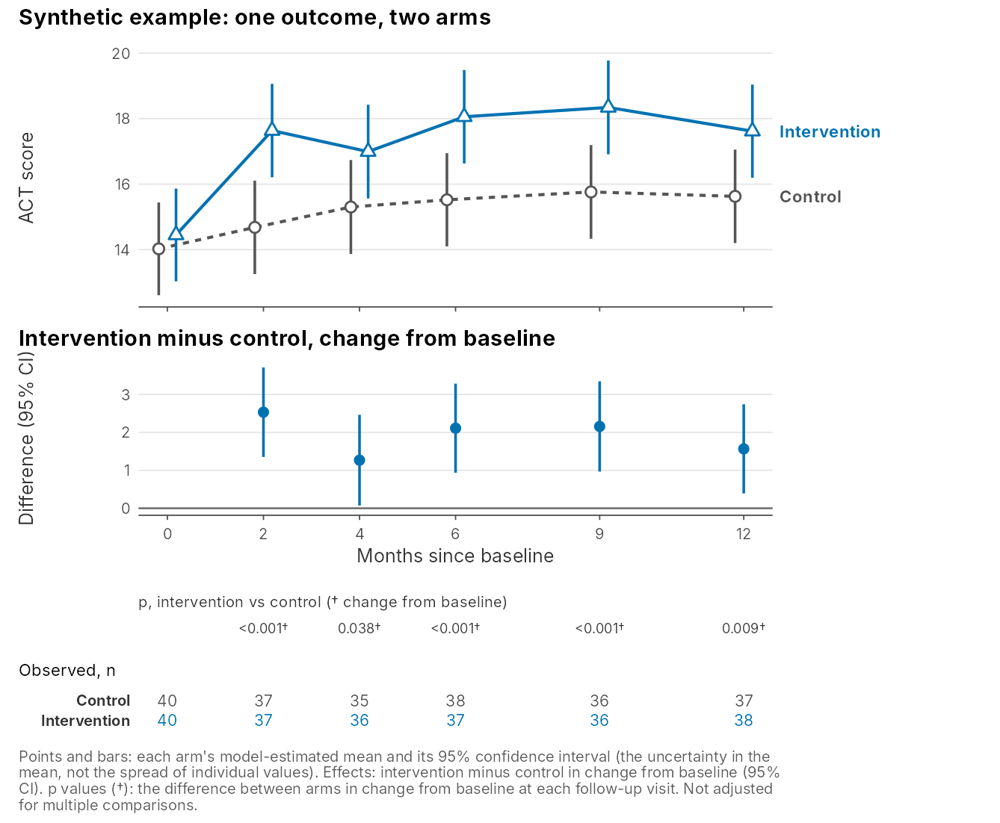
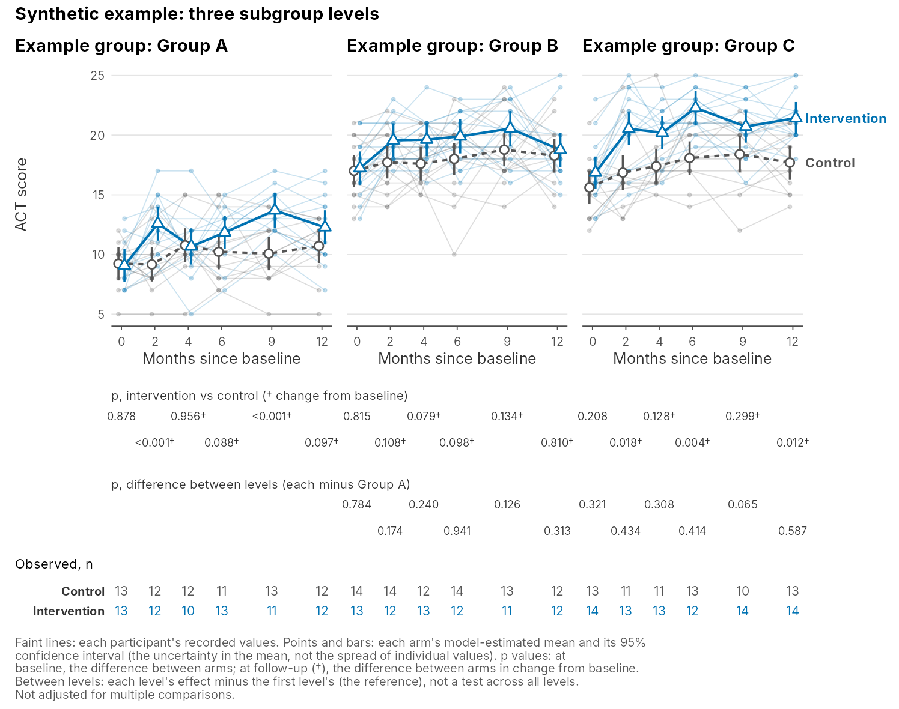

Each repeated outcome in this analysis is shown in one kind of figure: the outcome at every visit, by arm, with the model's estimates and the tests drawn from them. This page explains what each part of that figure shows and what it does not.

The two figures below are drawn from **synthetic data**, invented by the test code, so the numbers in them are not trial results. The subgroup in the second figure ("Example group") is invented too.

## One outcome, two arms

{fig-alt="Synthetic example figure. Top panel: ACT score from month 0 to month 12 for the control arm (gray circles, dashed line) and the intervention arm (blue triangles, solid line), each point with a vertical 95% confidence interval; the arms start close together and the intervention arm is higher at every follow-up visit. Middle panel: intervention minus control in change from baseline at months 2 to 12, each with its interval, above a line at zero. Below: a row of p values for each follow-up visit marked with a dagger, then the number of participants observed in each arm at each visit."}

Read the figure from top to bottom.

**Points and bars.** Each point is an arm's mean at that visit, as estimated by the mixed model, and the bar is its 95% confidence interval. The interval describes how precisely the mean is estimated, not how spread out the participants are. The two arms are drawn slightly apart at each visit so their bars do not overlap; both belong to the same visit. Color, point shape and line type all differ between the arms, so the figure can be read in grayscale.

**Faint lines** (in the second figure) are each participant's recorded values, joined across visits. They show the spread and the shape of individual courses that the means summarize. Some figures leave them out, and a figure for a group small enough to identify people should not be drawn this way at all.

**The effect panel**, when present, shows the comparison the trial is about: at each follow-up visit, the intervention arm's change from baseline minus the control arm's change from baseline, with its 95% confidence interval. Zero means no difference between the arms. This is not the same as the gap between the two plotted means at that visit, because it also takes away any difference between the arms at baseline.

**p values** are the tests of the same comparisons:

- At baseline (month 0, no mark): whether the arms differ at the start.
- At each follow-up (marked †): whether the arms differ in change from baseline, the difference shown in the effect panel.

They are shown to three decimals, and as "<0.001" when smaller. A blank means the model gave no estimate for that visit. A figure can leave out the baseline test, as the one above does; month 0 then has no p value, and the caption says so. The second figure shows it.

**Observed, n** is the number of participants in each arm with the outcome recorded at that visit. It falls when visits are missed. The means and intervals come from the model, which uses every recorded value, not only participants seen at every visit.

## Figures by subgroup

{fig-alt="Synthetic example figure with three panels side by side, Group A, Group B and Group C, on the same ACT score scale from month 0 to month 12. Each panel shows faint individual trajectories and the two arms' estimated means with 95% confidence intervals. Below the panels: p values for intervention versus control within each group, then p values for the difference between levels under Groups B and C, then the number of participants observed in each arm at each visit in each group."}

When the analysis looks at a subgroup, each level gets its own panel with its own participants, all on the same scale. The p values under each panel test the intervention against the control within that level, read as above.

The row headed "difference between levels" asks a different question: is the effect in this level different from the effect in the first level? Each value sits under the level it concerns, and the first level, the reference, has none. This compares one level with the reference; it is not a single test of whether the effect differs across all the levels. [What a p-value for interaction means](methods_interaction_p_values.qmd) explains why these tests answer a different question from the within-level ones, and why they need more data to detect a difference.

When three or more levels share the width, alternate p values sit on a second line so that they do not run into each other. They still line up with their visits.

## Cautions

- **Many tests, no adjustment.** Each figure carries a p value for every visit, and the analysis has many figures. None of the p values is adjusted for multiple comparisons, so some small p values are expected by chance.
- **Intervals that overlap** can still belong to arms that differ, and intervals that do not overlap are not a test. Use the effect panel or the p value for the comparison.
- **The same figure, read differently.** The same picture of means can come from different patterns in individuals. The faint lines, where shown, are the check.

[How this code does it](methods_in_this_code.qmd#estimates-and-plots) says which code produces each element.
